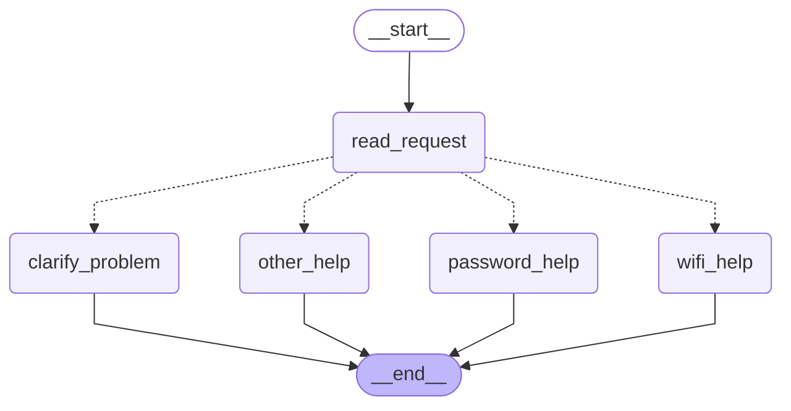

# HW5 — My LangGraph helpdesk

## Part 1 — How the graph works

### My graph and state

The state has three fields:

| Field | What it holds |
| --- | --- |
| `message` | The user's original message |
| `category` | `wifi`, `password`, `other` (or `both` in the changed graph), set by `read_request` |
| `reply` | The text produced by a help node |

Graph generated from my code with `get_graph().draw_mermaid()`. Solid arrows are fixed edges. Dotted arrows are the conditional edge chosen by my `route` function.


What each node reads and changes:

| Node | Reads | Changes |
| --- | --- | --- |
| `read_request` | `message` | `category` |
| `wifi_help` | nothing from the state | `reply` (Wi-Fi steps from `helpdesk.json`) |
| `password_help` | nothing from the state | `reply` (password steps from `helpdesk.json`) |
| `other_help` | nothing from the state | `reply` (asks whether the problem is Wi-Fi or a password) |
| `route` (conditional edge) | `category` | nothing; it only returns the name of the next node |

**Answers to the four questions**

1. **What information does each node read, and what does it change?** See the table above. Only `read_request` reads the user's message, and it writes `category`. Each help node writes `reply`.
2. **Node update vs. conditional edge.** A node returns a partial update (a dictionary) that LangGraph merges into the state. A conditional edge does not change the state. It reads the state and returns the name of the next node.
3. **What does the next node receive?** The current graph state, with all earlier updates already merged in. It does not receive only the previous node's update.
4. **What do `START`, `END` and compiling mean?** `START` and `END` are virtual entry and exit points of the graph. `compile()` checks that the graph structure is valid and returns an object that can be run.
   
### Predictions before running
I wrote these predictions from the routing rules in the brief (Wi-Fi is checked first, then password, then everything else; case is ignored). I then compared them with the real runs saved in `outputs/part1_traces.json`.

| Message | Predicted route | Actual route | What I learned |
| --- | --- | --- | --- |
| I cannot connect to Wi-Fi. | read_request → wifi_help | read_request → wifi_help | "Wi-Fi" matches the first rule. |
| I forgot my PASSWORD. | read_request → password_help | read_request → password_help | Upper case does not matter because the message is lowercased before matching. |
| My laptop screen is broken. | read_request → other_help | read_request → other_help | No keyword matches, so the fallback node asks which topic the user means. |
| My Wi-Fi password does not work. | read_request → wifi_help | read_request → wifi_help | The message mentions both topics, but the Wi-Fi rule is checked first, so the password part is ignored. |

State after each node for the last message in the original graph (from `outputs/part1_traces.json`):

```
after read_request:
  {"message": "My Wi-Fi password does not work.", "category": "wifi"}
after wifi_help:
  {"message": "My Wi-Fi password does not work.", "category": "wifi",
   "reply": "[GUIDE-WIFI] Connect to the practice campus network\n1. Check that Wi-Fi is enabled and airplane mode is off.\n..."}
```

**What happens when a message mentions both Wi-Fi and a password.** In the original graph `read_request` uses `if / elif`. For "My Wi-Fi password does not work." the Wi-Fi condition is true, so the password condition is never checked. The user gets Wi-Fi instructions only, even though the message also mentions a password. The first matching rule causes this.

### My change to the graph

I added a node `clarify_problem` and a second classifier `read_request_v2`. When a message mentions both Wi-Fi and a password, `category` becomes `both`, and the router sends the request to `clarify_problem`. That node asks which problem the user wants to solve first. The other three messages keep the same routes.



New execution trace for "My Wi-Fi password does not work.":

```
read_request -> clarify_problem

after read_request:
  {"message": "My Wi-Fi password does not work.", "category": "both"}
after clarify_problem:
  {"message": "My Wi-Fi password does not work.", "category": "both",
   "reply": "Your message mentions both Wi-Fi and a password. Which problem do you want to solve first: connecting to Wi-Fi, or recovering your account password?"}
```

Before the change the route was `read_request -> wifi_help`. After the change it is `read_request -> clarify_problem`, so the user is asked instead of receiving only half of the answer.

**What LangGraph controls, and what my functions decide.** LangGraph runs the nodes in order, merges each node's update into the shared state, and follows the edges, including the edge picked by the router. My Python functions decide how a message is classified (`read_request`, `read_request_v2`), which node name the router returns (`route`), and what each reply says. There is no model in Part 1, so no model makes any decision.

## Part 2 — Model and tools

### Model and provider

- **Provider:** OpenRouter (OpenAI-compatible API, base URL `https://openrouter.ai/api/v1`), used through `langchain-openai` (`ChatOpenAI`).
- **Model:** `openai/gpt-4o-mini`, temperature 0.
- The status profile, `user_id` and `thread_id` are set by my application when it builds the tools. The model cannot choose them.

### The model/tool loop


1. `model_node` sends the conversation and a system prompt to the model.
2. If the model's reply contains `tool_calls`, the conditional edge sends the state to `tool_node`. My code runs each requested tool and appends one `ToolMessage` per call.
3. The edge `tool_node → model_node` gives the results back to the model, which either requests another tool or writes the final answer.
4. If the reply has no `tool_calls`, the graph goes to `END`.

### Loop limit

The state has a `steps` counter. Each time `model_node` calls the model it returns `steps + 1`. At the start of `model_node`, if `steps >= MAX_STEPS` (8), the node does not call the model. It returns a fixed message saying the step limit was reached and sets `limit_reached = True`. That message has no tool calls, so the conditional edge ends the graph. I enforce the limit inside `model_node` because every cycle of the loop passes through it. LangGraph also has its own `recursion_limit` setting, which I did not change. `max_steps` and `limit_reached` are saved in every run log. In all runs below, `limit_reached` is `false`.

### Tools called directly (without the agent)

Saved in `outputs/part2_tools_direct.json`, produced by `python run_tools_direct.py` with the `normal` profile.

| Direct call | Result |
| --- | --- |
| `find_instructions("wifi")` | `GUIDE-WIFI`, title "Connect to the practice campus network", 4 steps |
| `find_instructions("printer")` | `error: unknown_topic`, supported topics `wifi` and `password` |
| `check_service_status("wifi")`, profile `normal` | `status: operational`, "The demo Wi-Fi service has no reported outage." |
| `prepare_ticket(...)` with category, summary and two steps tried | Local draft `HD-9D77C90A` (status `draft`, `reference_ids: ["GUIDE-WIFI"]`), saved under `local-storage/tickets/` |
| `prepare_ticket(...)` with empty `steps_tried` | `error: missing_information`, missing "steps already tried"; no ticket created and nothing invented |

`prepare_ticket` also refuses text that looks like a password, API key or recovery code, following `ticket_policy` in `helpdesk.json`.

### Predictions and actual runs

Request used for these three runs: *"Wi-Fi still does not work after I followed the instructions. Is it down? If it is working, help me prepare a ticket."*

I wrote the predictions from the rules in the brief and my system prompt, and compared them with the logs afterwards.

| Status snapshot | Predicted tool calls | Predicted final behaviour | Actual tool calls | Actual final behaviour |
| --- | --- | --- | --- | --- |
| `normal` | `check_service_status`, then possibly `prepare_ticket` | Service operational, so the model moves toward a ticket; it may ask for details because the request does not say which steps were tried | `check_service_status({"service": "wifi"})` only | Status `operational`. No ticket yet. The model asked for a description of the problem and the steps already tried. |
| `wifi_outage` | `check_service_status` only | Known outage explained, no ticket, no invented repair time | `check_service_status({"service": "wifi"})` only | Status `outage`. No ticket. No repair time given. |
| `status_unavailable` | `check_service_status` only | Says the status cannot be confirmed and offers a draft ticket | `check_service_status({"service": "wifi"})` only | Status `unknown`. The model said the status is neither operational nor a confirmed outage, offered a draft ticket and asked for details. No ticket yet. |

Logs: `outputs/part2_normal.json`, `outputs/part2_wifi_outage.json`, `outputs/part2_status_unavailable.json`.

The same request led to different behaviour only because the tool result was different. In all three runs the loop was `model_node → tool_node → model_node`. My predictions matched the runs. In the `normal` run no ticket was created because the request did not contain the steps already tried, and `prepare_ticket` needs them. The model asked the user instead of inventing them.

### One actual run with several tools

The first three runs used only one tool, so I ran a second request that contains the details a ticket needs:

*"My Wi-Fi does not connect to Campus-Demo. I already checked that Wi-Fi is on and airplane mode is off, and I forgot the network and reconnected. Please show me the official instructions, check whether Wi-Fi is down, and if it is working prepare a ticket for me."*

My prediction from the rules: the model calls `find_instructions` and `check_service_status`, and with an `operational` status it also calls `prepare_ticket`.

Run with profile `normal` (`outputs/part2_multi_normal.json`, model `openai/gpt-4o-mini` via OpenRouter, `limit_reached = false`):

```
Nodes: model_node -> tool_node -> model_node
TOOL REQUEST: [('find_instructions', {'topic': 'wifi'}), ('check_service_status', {'service': 'wifi'})]
TOOL RESULT : find_instructions -> GUIDE-WIFI, "Connect to the practice campus network", 4 steps
TOOL RESULT : check_service_status -> {"service": "wifi", "status": "operational", "message": "The demo Wi-Fi service has no reported outage.", "status_profile": "normal"}
FINAL ANSWER: The model listed the four official steps, said the Wi-Fi service is operational with no reported outage, and offered to prepare a ticket. It asked the user for a brief summary of the problem and any additional steps tried.
```

The model requested two tools in a single turn, and my `tool_node` ran both before the model was called again. The result of `check_service_status` decided what came next. The prediction was only partly right: the model did not call `prepare_ticket`. It asked for a summary and more steps even though my message already listed the steps I had tried. No ticket was created and nothing was invented, but the model was more cautious than I expected. I recorded this as a limitation (see "Choices and limitations").

The same request with the other two snapshots (`outputs/part2_multi_wifi_outage.json` and `outputs/part2_multi_status_unavailable.json`) called the same two tools and then behaved differently:

| Status snapshot | Tools called | Final behaviour |
| --- | --- | --- |
| `normal` | `find_instructions`, `check_service_status` | Status `operational`; offered a ticket and asked for details; no ticket created |
| `wifi_outage` | `find_instructions`, `check_service_status` | Status `outage`; said there is an outage with no repair time; refused to prepare a ticket |
| `status_unavailable` | `find_instructions`, `check_service_status` | Status `unknown`; said it cannot confirm if the service is operational or down; offered a draft ticket and asked for details |

### Answers to the four questions

1. **How does the graph decide between running a tool and ending with an answer?** After `model_node`, a conditional edge looks at the last message. If it has `tool_calls`, the graph goes to `tool_node`. If not, it goes to `END`. The decision depends on what the model returned, and the step limit stops the loop if the model keeps requesting tools.
2. **Which component requests a tool, and which executes it?** The model requests a tool by returning a tool call (a name and arguments). It does not run anything. My `tool_node` executes the Python function and returns the result to the model as a `ToolMessage`.
3. **What changes in the state after a tool result returns?** `messages` grows by one `ToolMessage` per tool call, because the `add_messages` reducer appends it to the history. When `model_node` runs again it reads the tool result and increases `steps` by 1.
4. **What makes this part different from the fixed routing rules in Part 1?** In Part 1, my Python rules chose the route from keywords, so the same message always took the same path. In Part 2, the model decides which tool to call, with which arguments, and when to stop, based on the user's message and on earlier tool results. My code only fixes the allowed tools, the loop structure and the step limit.

## Part 3 — Memory

TODO: explain conversation state, thread_id, user identifier, user preference storage, and retrieval from helpdesk.json.

| Situation | Command used | Log file | What happened |
| --- | --- | --- | --- |
| Refer to an earlier message | | | |
| Close, restart and resume | | | |
| Same user, new conversation | | | |
| Different user | | | |

## Part 4 — Running and checking my work

TODO: point to the README setup steps, package versions, memory-reset instructions, tests and GitHub Actions workflow. Explain which mistake each test catches and which runs use a fake model.

## Choices and limitations

TODO: explain the storage and libraries I chose, why they fit this task, and what still does not work reliably.

## Supplied scenarios — my actual results

| Scenario | Command or manual steps | Log file | What happened / what I changed |
| --- | --- | --- | --- |
| S01 — Simple Wi-Fi route | | | |
| S02 — Case-insensitive password route | | | |
| S03 — Unsupported request | | | |
| S04 — Two topics before the graph change | | | |
| S05 — Two topics after adding clarification | | | |
| S06 — Instructions then local ticket | | | |
| S07 — The same request during a Wi-Fi outage | | | |
| S08 — Status source unavailable | | | |
| S09 — Missing ticket details | | | |
| S10 — Use the current conversation | | | |
| S11 — Persist and recall after restart | | | |
| S12 — Preference across threads without replay | | | |
| S13 — Do not share memory between users | | | |
| S14 — Password recovery outage | | | |
