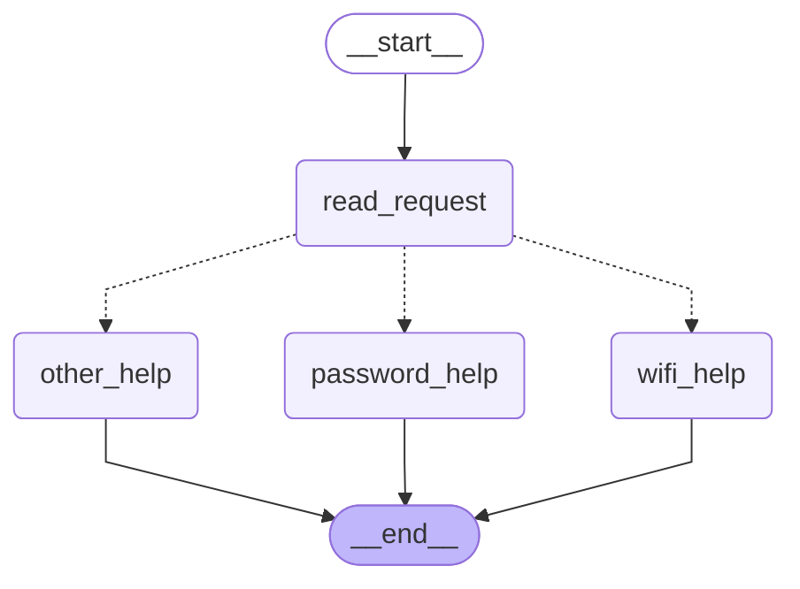
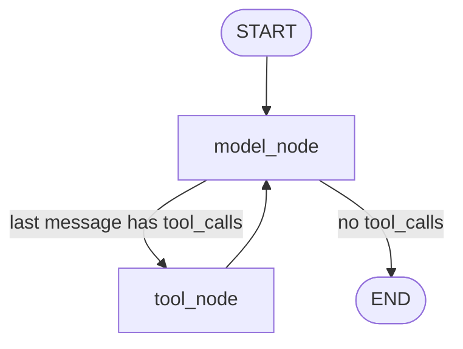

# HW5 — My LangGraph helpdesk

## Part 1 — How the graph works

### My graph and state

The state has three fields:

| Field | What it holds |
| --- | --- |
| `message` | The user's original message |
| `category` | `wifi`, `password`, `other` (or `both` in the changed graph), set by `read_request` |
| `reply` | The text produced by a help node |

Graph generated from my code with `get_graph().draw_mermaid()`. Solid arrows are fixed edges. Dotted arrows are the conditional edge chosen by my `route` function.


What each node reads and changes:

| Node | Reads | Changes |
| --- | --- | --- |
| `read_request` | `message` | `category` |
| `wifi_help` | nothing from the state | `reply` (Wi-Fi steps from `helpdesk.json`) |
| `password_help` | nothing from the state | `reply` (password steps from `helpdesk.json`) |
| `other_help` | nothing from the state | `reply` (asks whether the problem is Wi-Fi or a password) |
| `route` (conditional edge) | `category` | nothing; it only returns the name of the next node |

**Answers to the four questions**

1. **What information does each node read, and what does it change?** See the table above. Only `read_request` reads the user's message, and it writes `category`. Each help node writes `reply`.
2. **Node update vs. conditional edge.** A node returns a partial update (a dictionary) that LangGraph merges into the state. A conditional edge does not change the state. It reads the state and returns the name of the next node.
3. **What does the next node receive?** The current graph state, with all earlier updates already merged in. It does not receive only the previous node's update.
4. **What do `START`, `END` and compiling mean?** `START` and `END` are virtual entry and exit points of the graph. `compile()` checks that the graph structure is valid and returns an object that can be run.
   
### Predictions before running
I wrote these predictions from the routing rules in the brief (Wi-Fi is checked first, then password, then everything else; case is ignored). I then compared them with the real runs saved in `outputs/part1_traces.json`.

| Message | Predicted route | Actual route | What I learned |
| --- | --- | --- | --- |
| I cannot connect to Wi-Fi. | read_request → wifi_help | read_request → wifi_help | "Wi-Fi" matches the first rule. |
| I forgot my PASSWORD. | read_request → password_help | read_request → password_help | Upper case does not matter because the message is lowercased before matching. |
| My laptop screen is broken. | read_request → other_help | read_request → other_help | No keyword matches, so the fallback node asks which topic the user means. |
| My Wi-Fi password does not work. | read_request → wifi_help | read_request → wifi_help | The message mentions both topics, but the Wi-Fi rule is checked first, so the password part is ignored. |

State after each node for the last message in the original graph (from `outputs/part1_traces.json`):

```
after read_request:
  {"message": "My Wi-Fi password does not work.", "category": "wifi"}
after wifi_help:
  {"message": "My Wi-Fi password does not work.", "category": "wifi",
   "reply": "[GUIDE-WIFI] Connect to the practice campus network\n1. Check that Wi-Fi is enabled and airplane mode is off.\n..."}
```

**What happens when a message mentions both Wi-Fi and a password.** In the original graph `read_request` uses `if / elif`. For "My Wi-Fi password does not work." the Wi-Fi condition is true, so the password condition is never checked. The user gets Wi-Fi instructions only, even though the message also mentions a password. The first matching rule causes this.

### My change to the graph

I added a node `clarify_problem` and a second classifier `read_request_v2`. When a message mentions both Wi-Fi and a password, `category` becomes `both`, and the router sends the request to `clarify_problem`. That node asks which problem the user wants to solve first. The other three messages keep the same routes.


New execution trace for "My Wi-Fi password does not work.":

```
read_request -> clarify_problem

after read_request:
  {"message": "My Wi-Fi password does not work.", "category": "both"}
after clarify_problem:
  {"message": "My Wi-Fi password does not work.", "category": "both",
   "reply": "Your message mentions both Wi-Fi and a password. Which problem do you want to solve first: connecting to Wi-Fi, or recovering your account password?"}
```

Before the change the route was `read_request -> wifi_help`. After the change it is `read_request -> clarify_problem`, so the user is asked instead of receiving only half of the answer.

**What LangGraph controls, and what my functions decide.** LangGraph runs the nodes in order, merges each node's update into the shared state, and follows the edges, including the edge picked by the router. My Python functions decide how a message is classified (`read_request`, `read_request_v2`), which node name the router returns (`route`), and what each reply says. There is no model in Part 1, so no model makes any decision.

## Part 2 — Model and tools

### Model and provider

- **Provider:** OpenRouter (OpenAI-compatible API, base URL `https://openrouter.ai/api/v1`), used through `langchain-openai` (`ChatOpenAI`).
- **Model:** `openai/gpt-4o-mini`, temperature 0.
- The status profile, `user_id` and `thread_id` are set by my application when it builds the tools. The model cannot choose them.

### The model/tool loop



1. `model_node` sends the conversation and a system prompt to the model.
2. If the model's reply contains `tool_calls`, the conditional edge sends the state to `tool_node`. My code runs each requested tool and appends one `ToolMessage` per call.
3. The edge `tool_node → model_node` gives the results back to the model, which either requests another tool or writes the final answer.
4. If the reply has no `tool_calls`, the graph goes to `END`.

### Loop limit

The state has a `steps` counter. Each time `model_node` calls the model it returns `steps + 1`. At the start of `model_node`, if `steps >= MAX_STEPS` (8), the node does not call the model. It returns a fixed message saying the step limit was reached and sets `limit_reached = True`. That message has no tool calls, so the conditional edge ends the graph. I enforce the limit inside `model_node` because every cycle of the loop passes through it. LangGraph also has its own `recursion_limit` setting, which I did not change. `max_steps` and `limit_reached` are saved in every run log. In all runs below, `limit_reached` is `false`.

### Tools called directly (without the agent)

Saved in `outputs/part2_tools_direct.json`, produced by `python run_tools_direct.py` with the `normal` profile.

| Direct call | Result |
| --- | --- |
| `find_instructions("wifi")` | `GUIDE-WIFI`, title "Connect to the practice campus network", 4 steps |
| `find_instructions("printer")` | `error: unknown_topic`, supported topics `wifi` and `password` |
| `check_service_status("wifi")`, profile `normal` | `status: operational`, "The demo Wi-Fi service has no reported outage." |
| `prepare_ticket(...)` with category, summary and two steps tried | Local draft `HD-9D77C90A` (status `draft`, `reference_ids: ["GUIDE-WIFI"]`), saved under `local-storage/tickets/` |
| `prepare_ticket(...)` with empty `steps_tried` | `error: missing_information`, missing "steps already tried"; no ticket created and nothing invented |

`prepare_ticket` also refuses text that looks like a password, API key or recovery code, following `ticket_policy` in `helpdesk.json`.

### Predictions and actual runs

Request used for these three runs: *"Wi-Fi still does not work after I followed the instructions. Is it down? If it is working, help me prepare a ticket."*

I wrote the predictions from the rules in the brief and my system prompt, and compared them with the logs afterwards.

| Status snapshot | Predicted tool calls | Predicted final behaviour | Actual tool calls | Actual final behaviour |
| --- | --- | --- | --- | --- |
| `normal` | `check_service_status`, then possibly `prepare_ticket` | Service operational, so the model moves toward a ticket; it may ask for details because the request does not say which steps were tried | `check_service_status({"service": "wifi"})` only | Status `operational`. No ticket yet. The model asked for a description of the problem and the steps already tried. |
| `wifi_outage` | `check_service_status` only | Known outage explained, no ticket, no invented repair time | `check_service_status({"service": "wifi"})` only | Status `outage`. No ticket. No repair time given. |
| `status_unavailable` | `check_service_status` only | Says the status cannot be confirmed and offers a draft ticket | `check_service_status({"service": "wifi"})` only | Status `unknown`. The model said the status is neither operational nor a confirmed outage, offered a draft ticket and asked for details. No ticket yet. |

Logs: `outputs/part2_normal.json`, `outputs/part2_wifi_outage.json`, `outputs/part2_status_unavailable.json`.

The same request led to different behaviour only because the tool result was different. In all three runs the loop was `model_node → tool_node → model_node`. My predictions matched the runs. In the `normal` run no ticket was created because the request did not contain the steps already tried, and `prepare_ticket` needs them. The model asked the user instead of inventing them.

### One actual run with several tools

The first three runs used only one tool, so I ran a second request that contains the details a ticket needs:

*"My Wi-Fi does not connect to Campus-Demo. I already checked that Wi-Fi is on and airplane mode is off, and I forgot the network and reconnected. Please show me the official instructions, check whether Wi-Fi is down, and if it is working prepare a ticket for me."*

My prediction from the rules: the model calls `find_instructions` and `check_service_status`, and with an `operational` status it also calls `prepare_ticket`.

Run with profile `normal` (`outputs/part2_multi_normal.json`, model `openai/gpt-4o-mini` via OpenRouter, `limit_reached = false`):

```
Nodes: model_node -> tool_node -> model_node
TOOL REQUEST: [('find_instructions', {'topic': 'wifi'}), ('check_service_status', {'service': 'wifi'})]
TOOL RESULT : find_instructions -> GUIDE-WIFI, "Connect to the practice campus network", 4 steps
TOOL RESULT : check_service_status -> {"service": "wifi", "status": "operational", "message": "The demo Wi-Fi service has no reported outage.", "status_profile": "normal"}
FINAL ANSWER: The model listed the four official steps, said the Wi-Fi service is operational with no reported outage, and offered to prepare a ticket. It asked the user for a brief summary of the problem and any additional steps tried.
```

The model requested two tools in a single turn, and my `tool_node` ran both before the model was called again. The result of `check_service_status` decided what came next. The prediction was only partly right: the model did not call `prepare_ticket`. It asked for a summary and more steps even though my message already listed the steps I had tried. No ticket was created and nothing was invented, but the model was more cautious than I expected. I recorded this as a limitation (see "Choices and limitations").

The same request with the other two snapshots (`outputs/part2_multi_wifi_outage.json` and `outputs/part2_multi_status_unavailable.json`) called the same two tools and then behaved differently:

| Status snapshot | Tools called | Final behaviour |
| --- | --- | --- |
| `normal` | `find_instructions`, `check_service_status` | Status `operational`; offered a ticket and asked for details; no ticket created |
| `wifi_outage` | `find_instructions`, `check_service_status` | Status `outage`; said there is an outage with no repair time; refused to prepare a ticket |
| `status_unavailable` | `find_instructions`, `check_service_status` | Status `unknown`; said it cannot confirm if the service is operational or down; offered a draft ticket and asked for details |

### Answers to the four questions

1. **How does the graph decide between running a tool and ending with an answer?** After `model_node`, a conditional edge looks at the last message. If it has `tool_calls`, the graph goes to `tool_node`. If not, it goes to `END`. The decision depends on what the model returned, and the step limit stops the loop if the model keeps requesting tools.
2. **Which component requests a tool, and which executes it?** The model requests a tool by returning a tool call (a name and arguments). It does not run anything. My `tool_node` executes the Python function and returns the result to the model as a `ToolMessage`.
3. **What changes in the state after a tool result returns?** `messages` grows by one `ToolMessage` per tool call, because the `add_messages` reducer appends it to the history. When `model_node` runs again it reads the tool result and increases `steps` by 1.
4. **What makes this part different from the fixed routing rules in Part 1?** In Part 1, my Python rules chose the route from keywords, so the same message always took the same path. In Part 2, the model decides which tool to call, with which arguments, and when to stop, based on the user's message and on earlier tool results. My code only fixes the allowed tools, the loop structure and the step limit.

## Part 3 — Memory

### Two kinds of memory

| | Conversation memory | User memory |
| --- | --- | --- |
| What it holds | Earlier messages in one conversation: the problem, steps already tried, tool results | A saved preference of one user (reply language) |
| Mechanism | LangGraph checkpointer (`SqliteSaver`), file `local-storage/conversations.sqlite` | JSON file `local-storage/user_memory.json`, one entry per `user_id` |
| Key | `thread_id` (combined with `user_id`) | `user_id` |
| Lifetime | Until the thread is reset | Across all threads of the same user |

Both files are in `local-storage/`, which is ignored by git. They survive closing and restarting the program because they are files on disk.

**Conversation state.** After every step LangGraph saves a checkpoint of the state (message history and counters) under a key. When a turn starts with the same key, the saved messages are loaded first, so the model sees what was said before. That is why "I already tried that" can be understood. The `steps` counter is reset at the start of each turn so the loop limit applies per turn.

**`thread_id` vs. user identifier.** A `thread_id` identifies one conversation. A `user_id` identifies the person. One user can have many threads, and a preference belongs to the user, not to a thread. My application supplies both values, and the model cannot choose them. The checkpoint key is `user_id:thread_id`, so two users that use the same thread name still get separate histories.

**User preference storage.** The model can save a preference only through the tool `save_language_preference`, and only when the user asks for it. The tool writes to `user_memory.json` under the `user_id` fixed by my application. At each model call my code reads that file and adds the saved language to the system prompt. Preferences are not read from `demo_users.json`.

**Retrieval vs. memory.** Looking up Wi-Fi or password instructions in `data/helpdesk.json` is *retrieval*: shared reference knowledge that is the same for everyone. Remembering that this user wants replies in Kazakh is *memory*: information about one person, learned from their own message, which must not reach another user. The log field `source` shows the difference.

### Predictions

I wrote this table after the runs, from the design of the memory (checkpoint key `user_id:thread_id`, preferences stored per `user_id`), so these are design-based predictions that I checked against the logs, not blind predictions.

| Situation | Conversation memory I expected to be read | User memory I expected to be read | Behaviour I expected |
| --- | --- | --- | --- |
| Refer to an earlier message | Turn 1: nothing. Turn 2: the messages of the same thread. | Nothing saved yet | The model uses the earlier turn to understand "that" |
| Close, restart and resume | The same thread's messages, loaded from the SQLite file by a new process | Nothing saved yet | A correct summary of the earlier conversation |
| Same user, new conversation | Nothing in a new thread; the old thread is not loaded | The saved Kazakh preference | Replies in Kazakh, but does not know the problem from the first thread |
| Different user | Only that user's own thread | Empty, because the preference belongs to `demo-user-a` | English replies, and no access to the other user's preference |

### What I ran and what happened

Every command starts a **new Python process** (the process id is saved in the log). All commands use `--profile normal --log outputs/part3_demo.json`. Each log entry records the process id, user, thread, number of earlier messages loaded (conversation memory), preferences read (user memory), the tools called with their data source, and what was written to memory.

| Situation | Command used | Log file | What happened |
| --- | --- | --- | --- |
| Refer to an earlier message | `python chat.py --reset --scenario demo1 --user demo-user-a --thread thread-1 ... --message "My Wi-Fi does not connect to Campus-Demo."` then `... --message "I already tried that."`; stronger repeat: `--scenario demo1b --thread thread-4` with `"... What should I try?"` then `"I already tried that."` | `outputs/part3_demo.json` (`demo1`, `demo1b`) | In `demo1` turn 2 (pid 28340) loaded 4 earlier messages and still knew the problem was Campus-Demo, but the assistant had given no instructions in turn 1, so "that" had nothing specific to point to and the model asked again about my steps. In `demo1b` turn 1 called `find_instructions("wifi")`. Turn 2 (new process, pid 23800) loaded 4 earlier messages and called `check_service_status`, which is the last step of those instructions, so "that" was understood. It then asked for the problem and steps again instead of creating a ticket. |
| Close, restart and resume | `python chat.py --scenario demo2 --user demo-user-a --thread thread-1 ... --message "Please summarize what we have discussed so far and what I should do next."` | `outputs/part3_demo.json` (`demo2`) | A new process (pid 18160) resumed `thread-1` and loaded 6 earlier messages. The summary listed the Wi-Fi problem, the operational status check and the missing steps. |
| Same user, new conversation | `python chat.py --scenario demo3 --user demo-user-a --thread thread-1 ... --message "Please reply in Kazakh from now on."`, then `--thread thread-2 ... --message "How do I recover my password?"`, then `--thread thread-2 ... --message "What problem did I report earlier in this conversation?"` | `outputs/part3_demo.json` (`demo3`) | `thread-1`: the model called `save_language_preference("Kazakh")`, and the preference was written to user memory. `thread-2` (pid 384): 0 earlier messages, preference read as Kazakh, the model called `find_instructions("password")` (helpdesk reference file) and answered in Kazakh. Asked what I had reported, it answered only from `thread-2` (password recovery), not from the Wi-Fi problem in `thread-1`. |
| Different user | `python chat.py --scenario demo4 --user demo-user-b --thread thread-3 ... --message "How do I connect to Wi-Fi?"`, then `... --message "Which language preference do you have saved for me?"` | `outputs/part3_demo.json` (`demo4`) | `demo-user-b` had no stored preference (`read_user_memory` was empty) and got English replies with the Wi-Fi steps from `helpdesk.json`. Asked about a saved preference, the model said none was saved. `local-storage/user_memory.json` contains only `demo-user-a`. |

Where the information came from in each demonstration:

- **Conversation memory:** `read_conversation_memory.earlier_messages_loaded` in the log (the checkpointer).
- **User memory:** `read_user_memory` before a turn and `user_memory_after` after it (`user_memory.json`).
- **Helpdesk reference file:** tool requests with the source "helpdesk reference file (data/helpdesk.json)" or "service status snapshot".

The preference travelled to a new thread of the same user, while the conversation did not, and it never reached `demo-user-b`. All four situations behaved as predicted. The only weak result was the first attempt at "Refer to an earlier message": the assistant had given no instructions in turn 1, so "that" had nothing specific to refer to, which is why I added the `demo1b` run. In `demo1b` the earlier messages were used correctly, but the model still asked for the problem and the steps again instead of preparing a ticket, so it is more cautious than I expected. Nothing from `demo-user-a` reached `demo-user-b`.

## Part 4 — Running and checking my work

- **Setup, run commands, memory locations and reset:** see `README.md` (Python 3.12, `pip install -r requirements.txt`, copy `.env.example` to `.env`).
- **Package versions:** `requirements.txt` holds the exact versions from my environment (`pip freeze` of the packages I import and their LangChain/LangGraph core).
- **Tests:** `python -m pytest -q`, in `tests/test_helpdesk.py`.
- **GitHub Actions:** `.github/workflows/tests.yml` installs the pinned packages and runs the tests on every push, without any API key.

The tests use a **scripted fake model** (`FakeModel`). It returns fixed replies and tool requests, so the tests check my code (graphs, tools, memory), not the quality of a real model. All demos, S06–S14 and the Part 2/3 runs use the real model `openai/gpt-4o-mini` through OpenRouter; S01–S05 use no model.

| Test | Mistake it would catch |
| --- | --- |
| `test_original_graph_routes` | A wrong route, for example password text going to the Wi-Fi node, or case-sensitive matching |
| `test_clarify_graph_asks_when_both_topics` | The clarification node not being reached, or other routes changing after my graph change |
| `test_find_instructions_known_and_unknown` | A wrong instruction id, or an unknown topic returning made-up steps |
| `test_status_follows_selected_snapshot` | The status tool ignoring the selected snapshot, or mapping password to the wrong service |
| `test_ticket_contains_only_given_steps_and_is_saved` | A ticket with invented steps, a wrong template field, or no local file |
| `test_ticket_needs_details_and_writes_nothing` | A ticket created from missing information |
| `test_ticket_rejects_secrets` | A password or recovery code being written into a ticket |
| `test_loop_runs_requested_tool_and_returns_result_to_model` | The tool result not reaching the model, or the loop not ending after the answer |
| `test_loop_limit_stops_a_model_that_never_stops` | An endless tool loop (the step limit not working) |
| `test_user_memory_persists_and_is_per_user` | A preference lost after reload, or shared between users |
| `test_memory_tool_writes_only_for_its_fixed_user` | The model choosing whose memory to write, or a language value used to inject text |
| `test_conversation_survives_reconnect_and_stays_with_its_key` | Conversation state lost after closing the database, or leaking to another user's key |
| `test_saved_preference_reaches_only_its_own_users_prompt` | The saved language appearing in another user's prompt |

## Choices and limitations

- **Storage:** SQLite (LangGraph `SqliteSaver`) for conversation state, because it is a single local file, survives restarts and is included in the supplied dependencies. A small JSON file for user preferences, because there is only one preference type and it is easy to inspect and reset. Both live in `local-storage/`, which git ignores.
- **Libraries:** `langgraph` for the graphs, `langchain-openai` for the model client (also used for OpenRouter through its OpenAI-compatible API), `pytest` for tests.
- **Tool access:** `user_id`, `thread_id` and the status profile are fixed by my application inside the tools; the model cannot choose them.
- **Model behaviour depends on the prompt.** With `gpt-4o-mini` my first system prompt created a ticket during S08 (status unknown), and created tickets nobody asked for in S10 and S11. A second version made S06 regress (the model asked again for details it already had). The final prompt has explicit ticket rules and three examples. The logs of the earlier versions are in `outputs/first_prompt/` and `outputs/second_prompt/`.
- **Remaining weaknesses:** in S14 the model still mentions that it cannot prepare a ticket although none was requested. In S09 it prepared the ticket without calling `check_service_status` first (the ticket tool reads the snapshot itself). Saving a preference depends on the model deciding to call `save_language_preference`; it worked in my runs but nothing forces it. Earlier Part 2 and Part 3 logs were made with earlier versions of the system prompt. Replies in Kazakh were not checked by a fluent reader.
- **Tests do not measure the real model.** They check the graph structure, tools and memory with a fake model.

## Supplied scenarios — my actual results

Every scenario was run with `python run_scenarios.py` (all at once, or `--only S06` for one). The runner reads `data/scenarios.json`, resets storage when `reset_before` is true, and starts a **new Python process** at every `restart_process` event and whenever the user or thread changes. S01–S05 use the Part 1 graph (no model). S06–S14 use the agent through `chat.py` with `openai/gpt-4o-mini` via OpenRouter. Final logs are `outputs/S01.json` … `outputs/S14.json`; ticket drafts are copied to `outputs/tickets/`.

| Scenario | Command or manual steps | Log file | What happened / what I changed |
| --- | --- | --- | --- |
| S01 — Simple Wi-Fi route | `python run_scenarios.py --only S01` | `outputs/S01.json` | `read_request -> wifi_help`; reply is the GUIDE-WIFI steps. Nothing to change. |
| S02 — Case-insensitive password route | `python run_scenarios.py --only S02` | `outputs/S02.json` | `read_request -> password_help`; "PASSWORD" matched because the message is lowercased. |
| S03 — Unsupported request | `python run_scenarios.py --only S03` | `outputs/S03.json` | `read_request -> other_help`; the fallback asks whether the problem is Wi-Fi or a password. |
| S04 — Two topics before the graph change | `python run_scenarios.py --only S04` (original graph) | `outputs/S04.json` | `read_request -> wifi_help`: the Wi-Fi rule is checked first, so the password part of "My Wi-Fi password does not work." is ignored. |
| S05 — Two topics after adding clarification | `python run_scenarios.py --only S05` (graph with `clarify_problem`) | `outputs/S05.json` | `read_request -> clarify_problem`: the classifier sets `category = both` and the router sends the request to a new node that asks which problem to solve first. The route changed, not just the wording. |
| S06 — Instructions then local ticket | `python run_scenarios.py --only S06` (two turns, one process) | `outputs/S06.json`, ticket `outputs/tickets/HD-9545E44F.json` | Turn 1 called `find_instructions`. Turn 2 called `check_service_status` (operational) and `prepare_ticket`; the draft lists only the steps I stated. Earlier prompt versions failed here: after my first tightening of the ticket rule the model asked again for details it already had (`outputs/second_prompt/S06.json`). I added explicit rules and examples to the system prompt. |
| S07 — The same request during a Wi-Fi outage | `python run_scenarios.py --only S07` | `outputs/S07.json` | Only `check_service_status` was called (outage). No ticket was prepared, the answer explained the outage and gave no repair time. |
| S08 — Status source unavailable | `python run_scenarios.py --only S08` | `outputs/S08.json` | Status `unknown`: no ticket, the model said it could not confirm Wi-Fi was operating and offered a draft. In my first run it created ticket HD-97A4C279 anyway, which broke my condition "if it is operating" (`outputs/first_prompt/S08.json`). I changed the system prompt so `unknown` means: do not prepare, offer a draft. |
| S09 — Missing ticket details | `python run_scenarios.py --only S09` (two turns, one process) | `outputs/S09.json`, ticket `outputs/tickets/HD-ADF83A84.json` | Turn 1 asked for the problem and steps and called no tool. Turn 2 prepared a draft from my reply. The model did not call `check_service_status` in turn 2, but `prepare_ticket` read the snapshot itself, so the ticket records the status. The summary in the draft is short ("Wi-Fi issue"). |
| S10 — Use the current conversation | `python run_scenarios.py --only S10` (two turns, one process) | `outputs/S10.json` | Turn 2 loaded 4 earlier messages and repeated the steps I had tried. In earlier runs the assistant also prepared a ticket in turn 1 that nobody asked for (HD-D7F03D04, HD-8323C9B1). The final prompt says describing a problem is not a request for a ticket; the final run created none. |
| S11 — Persist and recall after restart | `python run_scenarios.py --only S11` (process 1, `restart_process`, process 2) | `outputs/S11.json` | Process 1 saved the Kazakh preference with `save_language_preference`. Process 2 (different process id) loaded 5 earlier messages, read the preference from user memory, and answered in Kazakh with the problem and steps. Earlier runs created an unrequested ticket in turn 1; fixed with the same prompt change as S10. |
| S12 — Preference across threads without replay | `python run_scenarios.py --only S12` (`preference-a1`, restart, `preference-a2`) | `outputs/S12.json` | In the new thread 0 earlier messages were loaded, but `read_user_memory` held `reply_language: Kazakh`, so the model answered in Kazakh about the language and its capabilities. The old transcript was not replayed. |
| S13 — Do not share memory between users | `python run_scenarios.py --only S13` | `outputs/S13.json` | `demo-user-b` had no stored preference and 0 earlier messages, and the model said no language or problem had been mentioned. `user_memory.json` held only `demo-user-a`. |
| S14 — Password recovery outage | `python run_scenarios.py --only S14` | `outputs/S14.json` | The model called `check_service_status` for password recovery (mapped to `account_recovery`, outage), gave no repair time and invented nothing. Limitation: it still said it could not prepare a ticket, which was not requested. |
